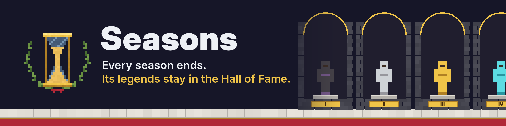

# Seasons



[](https://hangar.papermc.io/gr33nMari0/SeasonsMC) [](https://modrinth.com/project/seasonsmc) [](https://github.com/gr33nMari0/seasons/releases)

Seasons runs a season format on one Minecraft world that never resets. When a season ends, everyone's gear is archived into a Hall of Fame: each player gets a cell with a figure wearing their armour, a plaque and their whole inventory to look at. Then everyone starts again with nothing at a fresh spawn far out in new land. The old world stays locked until the group votes for Homecoming, and then the whole world opens up again. Nothing anyone built is ever wiped.

It is a server-side Paper plugin: players install nothing.

- **Hall of Fame.** Galleries of cells, one per player per season, assigned at random (or claimed, ordered or assigned by hand). Owners decorate their cell before the season ends; after that it's locked and view-only, and so is every archived item. Visitors use `/hof` from a bed, and `/hof leave` takes them back.
- **Rollover.** Reminders count down to a planned end you set. At a live event, `/season end` starts a ten-minute countdown, archives everyone online and resets them. Anyone offline is archived when they next log in. `/season launch` takes everyone to the new spawn with a fanfare.
- **Old world.** Zones you draw lock the old world (block, no-build or announce) until `/season unlock homecoming`. Ender chests go into a vault that opens at Homecoming.
- **Extras.** A dragon egg for each season's slayer, season firsts, awards with trophies, a season card for every player, registered pets that travel to the new spawn, a museum, curation of archived items, BlueMap areas and waypoints, and Discord posts.


Every step that moves items is journalled, so a crash at any moment leaves every item exactly once: archived or still carried, never both and never lost.

## Requirements

- Paper **26.3**, or a fork that runs Paper plugins, such as Purpur. Spigot and Folia are not supported.
- Java 25.
- Optional: [BlueMap](https://bluemap.bluecolored.de/) 5.24 or newer, for zones, spawn candidates and waypoints on the map. Any permissions plugin, such as LuckPerms, works.

## Install

1. Download `Seasons-<version>.jar` from [Hangar](https://hangar.papermc.io/gr33nMari0/SeasonsMC), [Modrinth](https://modrinth.com/project/seasonsmc) or [GitHub Releases](https://github.com/gr33nMari0/seasons/releases). Each release lists SHA-256 checksums in `SHA256SUMS`.
2. Put it in `plugins/` and restart the server.
3. Seasons writes `plugins/Seasons/config.yml`, `messages.yml` and `secrets.yml`. Every setting is described in the file itself and in the [configuration reference](https://github.com/gr33nMari0/seasons/blob/main/docs/config.md). Edit a file, then run `/season reload`. A broken file is reported with its line number, and the old settings stay in force.
4. For Discord posts, put your webhook URLs in `secrets.yml`, or in the environment variables `SEASONS_DISCORD_WEBHOOK` and `SEASONS_ADMIN_WEBHOOK`. Keep that file private.

Seasons sits idle until you record a season. Installing it mid-season is fine.

**Seasons Web**, the optional live dashboard (`SeasonsWeb-<version>.jar`), arrives in a later release. You don't need it.

## Your first season

Back up the world first, and try the rollover on a copy before doing it for real. Admin commands need op, or the permission nodes listed below. `/season help` and `/hof help` explain every command and its arguments, and tab completion fills them in.

1. **Record the season you're in.** On a server already partway through its own season 2, run `/season init 2`. The first `/season end` then archives Season 2. On a new server, `/season init 1`.
2. **Build the Hall.** Build it however you like, anywhere in the world: a hub with wings (galleries) of cells.
   - Mark the hub. Run `/hof wand` and click two corners with the wand, then `/hof hall hub`. Stand where visitors should arrive and run `/hof hall spawn`.
   - Make a gallery for the season: `/hof gallery create season-2 2`, then `/hof gallery bounds season-2` and `/hof gallery entry season-2`.
   - Add cells. You can tag cells you've already built with `/hof cell new season-2` and two wand corners, then add a figure, plaque and archive anchor by right-clicking blocks with the wand. `/hof cell row` repeats one cell along a hallway. `/hof stamp alcove season-2 10` pastes a ready-made template.
   - Run `/hof hall check`. It reports anything that doesn't fit together, and after each step Seasons suggests what usually comes next.
3. **Lock the old world.** Stand at its centre and run `/season zone add old-world cylinder <radius>`, with the radius just past your furthest build. Add more zones for other dimensions or outlying builds; `/season zone list` shows them. They lock at launch and open at Homecoming.
4. **Choose the next spawn.** Mark candidates in unexplored land with `/season spawn candidate add <name>`. They appear on BlueMap. Let the group vote, then run `/season spawn set <name>`.
5. **Set the end.** Run `/season schedule end 2026-12-20T20:00+00:00`. Reminders go out 7 days, 1 day, 1 hour and 10 minutes before, in chat and on Discord. The decorating window opens a week before the end, and everyone who played gets a cell. Players can swap cells with `/hof swap <player>`.
6. **The day before,** run `/season end --dry-run` and fix whatever it reports, such as too few cells.
7. **At the live event,** run `/season end`. After the countdown, every gallery locks, everyone online is archived into their cell, and owners get 15 minutes to arrange it. This is the Intermission.
8. **Launch** with `/season launch` (try `--dry-run` first). Everyone goes to the new spawn, and the old world locks.
9. **Homecoming,** whenever the group votes: `/season unlock homecoming`. Every zone opens, and vaults can be emptied.

`/season status` shows where things stand at any point.

## Commands

Players get these by default:

| Command | Does |
| --- | --- |
| `/hof [season\|player]` | Visit the Hall of Fame, from near a bed with no monsters about |
| `/hof leave` | Go back to where you were, checked for safety |
| `/hof swap <player>` | Swap cells during the decorating window; both players run it |
| `/hof claim [cell]` | Claim a cell, when the gallery uses `claim` assignment |
| `/hof gate open\|shut` | Open or shut your own cell's gate |
| `/vault` | Look at your ender vault, and take from it after Homecoming |
| `/pet add` / `remove <name>` / `list` | Register tamed pets (up to 5) to travel with you to the next spawn |
| `/season info` | The season, its phase, the planned end, your cell and archive |

Admin commands, ops by default:

| Group | Permission | Commands |
| --- | --- | --- |
| Season | `seasons.admin.season` | `/season status`, `init`, `schedule end\|show\|clear`, `end [--dry-run] [--now]`, `cancel`, `decorate open\|close`, `launch [--dry-run]`, `spawn ...`, `unlock homecoming`, `unlock\|lock <zone>`, `list`, `players`, `archive`, `unarchive`, `reprocess`, `firsts`, `tp` |
| Zones and settings | `seasons.admin.config` | `/season zone add\|mode\|after\|remove\|list\|info`, `config get\|set`, `reload`, `validate`, `marker ...`, `audit` |
| Hall | `seasons.admin.hof` | `/hof hall ...`, `gallery ...`, `cell ...`, `link ...`, `wand`, `sel`, `show`, `stamp`, `import`, `reconcile`, `restore`, `undo`, `list`, `locate`, `tp`, `/museum add\|remove` |
| Curation | `seasons.curate.*` | `/hof curate <player> <season>`, `/hof curate undo <id>` |

More nodes:

- `seasons.hof.anywhere` skips the `/hof` entry checks; ops have it by default.
- `seasons.hof.roam` lets the holder leave the Hall during the Intermission; ops have it by default.
- `seasons.zone.bypass` and `seasons.hof.bypass` ignore zones and the Hall's protection. Nobody has them by default, not even ops.
- `/season reset` wipes Seasons from a test world. Only server operators can run it, never through a permission, and only after two confirmations and typing DELETE.

The [specification](https://github.com/gr33nMari0/seasons/blob/main/docs/spec.md#commands-and-permissions) has the full list.

## Reading the log

At startup Seasons writes a short summary to the console, for example:

```
[Seasons] Seasons 1.1.0 on Paper, Java 25
[Seasons] Season 3: Active, Frontier stage, ends 1 Dec 2026, 18:00, 2 zones in force
[Seasons] Hall of Fame: hub set, 3 galleries, 64 cells (12 free)
[Seasons] Journal clean; 14 player records, 0 waiting to be archived
[Seasons] Discord: public webhook set, admin webhook not set
[Seasons] BlueMap: found; markers follow once it has loaded
[Seasons] Ready in 412 ms. /season info for details.
```

"Season: none recorded" means Seasons is idle: run `/season init <season>`. If setup needs attention, the last line says which command lists the problems. After that, Seasons writes one line for each milestone (the end, archiving, the launch, Homecoming, reloads), warnings for what needs your attention, and errors for what failed. Repeated warnings are limited so they never flood the console. To chase a problem, list areas under `logging.debug` in `config.yml` (`hall`, `archive`, `zones`, `discord`, `maps`, `commands`) and run `/season reload`; turn them off again afterwards. Webhook URLs are never written in full.

## Updating

Read the [changelog](https://github.com/gr33nMari0/seasons/blob/main/CHANGELOG.md), back up, then stop the server, replace the jar and start it again. Every Seasons file records its format version, so a newer Seasons can read older files. Archives store items as vanilla item data, which the game upgrades when it loads them, so they survive game updates.

## Metrics

Seasons uses [bStats](https://bstats.org/plugin/bukkit/SeasonsMC/35499) to count how many servers run it. It sends what bStats always sends (server software, game version, Java version, player count) and four anonymous charts: whether Seasons Web is installed, the cell assignment mode, the cell access mode, and how many seasons the server has run. It never sends player names, coordinates or addresses. To turn bStats off for every plugin, set `enabled: false` in `plugins/bStats/config.yml`.

## Help and security

Report bugs on [GitHub Issues](https://github.com/gr33nMari0/seasons/issues). Never report a dupe or an exploit in public: see [SECURITY.md](https://github.com/gr33nMari0/seasons/blob/main/SECURITY.md). To build Seasons or contribute, see [CONTRIBUTING.md](https://github.com/gr33nMari0/seasons/blob/main/CONTRIBUTING.md).

## Licence

Seasons, Seasons Web and the Seasons API are source-available under the [PolyForm Noncommercial License 1.0.0](https://github.com/gr33nMari0/seasons/blob/main/LICENSE). You can use, change and share them for anything noncommercial, such as running them on your friends' server. You may not sell them or use them commercially without written permission from Peter Woodhead, who can grant commercial licences. Bundled libraries keep their own licences: see [THIRD_PARTY_NOTICES.md](https://github.com/gr33nMari0/seasons/blob/main/THIRD_PARTY_NOTICES.md).
