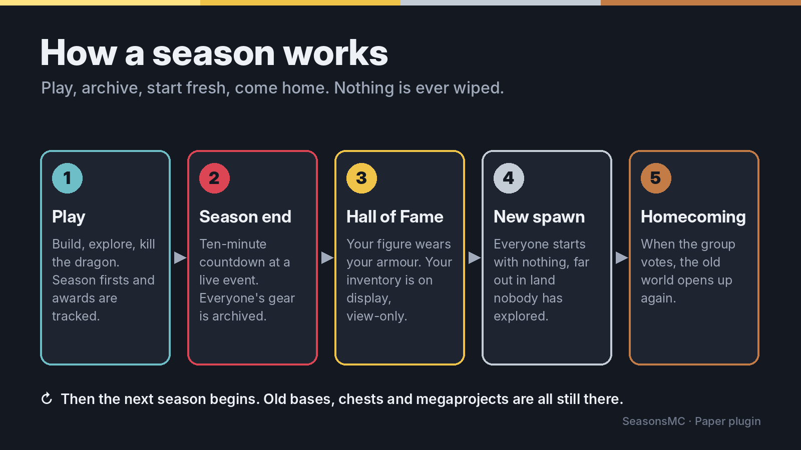

# Seasons

   

**Seasons runs your Minecraft server in seasons on one world that never resets.** When a season ends, everyone's gear goes on display in a Hall of Fame, everyone starts again at a fresh spawn in new land, and the old world stays locked until the group votes for Homecoming. Then the whole world opens up again. Nothing anyone built is ever wiped.

It's a server-side Paper plugin: players install nothing.

**[Documentation](https://seasonsmc.petepeterepeat.com/docs/)** · **[Download](https://seasonsmc.petepeterepeat.com/download/)** · **[Commands](https://seasonsmc.petepeterepeat.com/docs/reference/commands/)** · **[Changelog](CHANGELOG.md)**

## What it does

- **A Hall of Fame for every season.** Each player gets a cell: a figure wearing their armour in their skin, a chest of everything else they carried, and a season card with their stats, firsts and awards. View-only, forever. Works with any Hall you build.
- **One-button rollovers.** Reminders count down to a date you set; at a live event, `/season end` archives everyone online (and anyone offline when they next log in), and `/season launch` sends everyone, with their pets, to the new spawn.
- **The old world, locked until Homecoming.** Zones you draw lock old land (or make it no-build or announce-only), ender chests wait in a vault, and `/season unlock homecoming` opens it all at once.
- **Links anywhere.** Buttons, signs, plates, doorways and floating text that take players to the Hall, any season's spawn or a named point, open to everyone or a permission group.
- **Season extras.** A dragon egg for each season's slayer, season firsts, awards with trophies, a museum, curation of archived items, BlueMap markers and Discord posts.
- **Seasons Web, optional.** A live dashboard served from your own server for phones, tablets and second screens, which players can lay out themselves.

Every item move is journalled, so a crash at any moment leaves every item exactly once: archived or still carried, never both and never lost.

## Requirements

- Paper 26.3, or a fork that runs Paper plugins, such as Purpur. Spigot and Folia aren't supported.
- Java 25.
- Optional: BlueMap 5.24 or newer, and any permissions plugin, such as LuckPerms.

## Install

1. Download `Seasons-<version>.jar` from [Modrinth](https://modrinth.com/project/seasonsmc), [Hangar](https://hangar.papermc.io/gr33nMari0/SeasonsMC) or [GitHub Releases](https://github.com/gr33nMari0/seasons/releases). Each release lists SHA-256 checksums.
2. Put it in `plugins/` and restart.
3. For the dashboard, add `SeasonsWeb-<version>.jar` too and follow [Seasons Web](https://seasonsmc.petepeterepeat.com/docs/owners/seasons-web/).

## Getting started

1. `/season init <season>` records the season you're in.
2. `/hof wand`, then mark the Hall's hub, a gallery and its cells.
3. `/season zone add old-world cylinder <radius>` locks the old world.
4. `/season spawn set <name>` picks the next spawn; `/season schedule end <time>` sets the date.
5. At the live event: `/season end`, then `/season launch`.

The full walkthrough, with a checklist you can tick off, is **[Your first season](https://seasonsmc.petepeterepeat.com/docs/start/first-season/)**.

## Documentation

| | |
| --- | --- |
| [Start here](https://seasonsmc.petepeterepeat.com/docs/) | Install, your first season, how Seasons works, upgrading |
| [Running a server](https://seasonsmc.petepeterepeat.com/docs/owners/season-lifecycle/) | The lifecycle, rollover day, Homecoming, zones, the Hall, anchors, the museum, links |
| [Guides](https://seasonsmc.petepeterepeat.com/docs/guides/troubleshooting/) | Picking a spawn, importing a hand-built Hall, regenerating the End, troubleshooting |
| [Reference](https://seasonsmc.petepeterepeat.com/docs/reference/commands/) | Every command, permission and setting, generated from the code |

## Roadmap

Seasons has shipped its core (rollovers, the Hall of Fame, the old world and Homecoming, season extras, cell tooling), Seasons Web and reliable links. Next:

- Adapters for **Fabric** and **NeoForge**, on the same platform-neutral core.
- **Folia** support.
- **Bedrock** players through Geyser.
- Discord login for Seasons Web.

Progress, milestone by milestone, is in [docs/progress.md](docs/progress.md); the full design is in [docs/spec.md](docs/spec.md).

## Contributing and security

Bug reports and ideas are welcome on [GitHub Issues](https://github.com/gr33nMari0/seasons/issues). To build Seasons or contribute, see [CONTRIBUTING.md](CONTRIBUTING.md). **Never report a dupe or an exploit in public**: see [SECURITY.md](SECURITY.md).

## Licence

Seasons, Seasons Web and the Seasons API are source-available under the [PolyForm Noncommercial License 1.0.0](LICENSE). You can use, change and share them for anything noncommercial, such as running them on your community's server. You may not sell them or use them commercially without written permission from Peter Woodhead, who can grant commercial licences. Bundled libraries and fonts keep their own licences: see [THIRD_PARTY_NOTICES.md](THIRD_PARTY_NOTICES.md).
