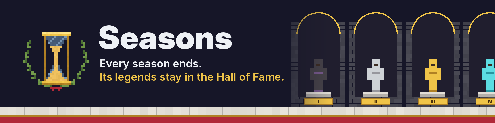

 |  | 

**Seasons** runs your server in seasons on one Minecraft world that never resets.

When a season ends, everyone's gear goes into a **Hall of Fame**: each player gets a cell with a figure wearing their armour, a plaque, and their whole inventory on display. Then everyone starts again with nothing, at a fresh spawn far out in land nobody has explored. The old world stays locked until the group votes for **Homecoming**, and then the whole world opens up again.

Nothing anyone built is ever wiped. It's a server-side Paper plugin, so players install nothing.

## How a season works

1. **Play.** Build, explore, kill the dragon. Season firsts are tracked as they happen.
2. **Season end.** Reminders count down to the date you set. At a live event, `/season end` starts a ten-minute countdown and archives everyone online. Anyone offline is archived when they next log in.
3. **Hall of Fame.** Everyone wakes up in the Hall. Owners get a few minutes to arrange their cell, then it's locked and view-only for good.
4. **New spawn.** `/season launch` takes everyone, and their registered pets, to the new spawn with a fanfare. The old world locks behind them.
5. **Homecoming.** Whenever the group votes for it, `/season unlock homecoming` opens every zone at once. Old bases, chests and megaprojects are all still there.

## Features

**The Hall of Fame**
- Galleries of cells, one per player per season. Cells are assigned at random, or claimed, ordered or assigned by hand.
- A figure in your armour, a plaque with your advancement count, and your whole inventory to look at but never take.
- A season card for every player with their stats, firsts and awards.
- Players decorate their cell in the week before the season ends and can swap cells with a friend.
- Visit from any bed with `/hof`; `/hof leave` takes you back to where you were.
- Build the Hall however you like. A wand, cell rows and ready-made templates (`/hof stamp`) make laying out cells quick, and `/hof hall check` tells you what's missing.

**The old world**
- Draw zones (circles, boxes, everything outside a radius, above or below a height) that block entry, block building or just announce, until Homecoming.
- Ender chests are sealed into a vault that opens at Homecoming.
- Spawn candidates show on BlueMap so the group can vote on the next one.

**Extras**
- A new dragon egg every season for its slayer, with a fanfare. Each one can go on an egg wall in the museum.
- Season firsts, awards with trophies, and a museum for one-off items.
- Registered pets (up to 5) travel with their owner to the new spawn.
- Curators can put archived items in the museum, return them or remove them, with every action audited.
- BlueMap markers for spawns, the Hall, the museum and every zone.
- Discord webhook posts for reminders, the season's end, the launch and more, plus a separate admin channel for alerts.

## Built so nothing is lost

Every step that moves an item is journalled before it happens. A crash at any moment leaves every item exactly once: archived or still carried, never both and never lost. Archives are stored as vanilla item data, which the game upgrades itself, so they survive Minecraft updates. Items on display are tagged, and a tagged copy found anywhere it shouldn't be is deleted and reported.

## Requirements

- **Paper 26.3**, or a fork that runs Paper plugins, such as Purpur. Spigot and Folia are not supported.
- **Java 25.**
- Optional: [BlueMap](https://bluemap.bluecolored.de/) 5.24 or newer, for zones, spawn candidates and waypoints on the map.
- Any permissions plugin, such as LuckPerms.

## Getting started

1. Put the jar in `plugins/` and restart. Seasons writes `config.yml`, `messages.yml` and `secrets.yml` to `plugins/Seasons/`. Every setting is explained in the file and in the [configuration reference](https://seasonsmc.petepeterepeat.com/docs/reference/config/).
2. Record the season you're in: `/season init 1` on a new server, or `/season init 2` if you're partway through your own season 2. Seasons sits idle until you do this, so installing it mid-season is fine.
3. Build the Hall, mark it with the wand (`/hof wand`) and add a gallery and cells.
4. Lock the old world with `/season zone add old-world cylinder <radius>`.
5. Pick the next spawn, set the end date with `/season schedule end <date>`, and run `/season end --dry-run` the day before.

**Back up your world and try a rollover on a copy first.** The [full walkthrough](https://seasonsmc.petepeterepeat.com/docs/start/first-season/) covers every step, and `/season help` and `/hof help` explain every command in-game.

## Player commands

| Command | Does |
| --- | --- |
| `/hof [season\|player]` | Visit the Hall of Fame from near a bed |
| `/hof leave` | Go back to where you were |
| `/hof swap <player>` | Swap cells during the decorating window |
| `/vault` | See your sealed ender chest, and take from it after Homecoming |
| `/pet add` / `remove` / `list` | Register pets to travel with you to the next spawn |
| `/season info` | The season, its phase, the planned end, your cell |

Admin commands sit under `/season` and `/hof`, are op-only by default, and are split into permission groups so you can hand out exactly what each rank needs. The [command reference](https://seasonsmc.petepeterepeat.com/docs/reference/commands/) lists every command and permission node.

## Links

- [Source code and full documentation](https://github.com/gr33nMari0/seasons)
- [Report a bug](https://github.com/gr33nMari0/seasons/issues). Please don't report dupes or exploits in public: see [SECURITY.md](https://github.com/gr33nMari0/seasons/blob/main/SECURITY.md).
- [Changelog](https://github.com/gr33nMari0/seasons/blob/main/CHANGELOG.md)

## Metrics

Seasons uses [bStats](https://bstats.org/plugin/bukkit/SeasonsMC/35499) to count servers. Besides what bStats always sends, it reports four anonymous charts (cell assignment mode, cell access mode, number of seasons run, and whether Seasons Web is installed). It never sends player names, coordinates or addresses. Turn it off in `plugins/bStats/config.yml`.

## Licence

Seasons is source-available under the [PolyForm Noncommercial License 1.0.0](https://github.com/gr33nMari0/seasons/blob/main/LICENSE). Use it, change it and share it for anything noncommercial, such as your friends' server. Commercial use needs written permission from Peter Woodhead.

---

